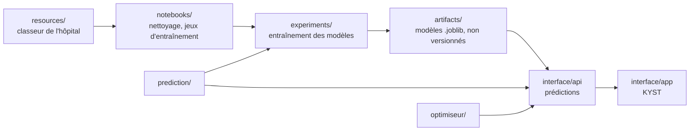

# KYST — programmation du bloc opératoire assistée par IA

Projet d'élèves ingénieurs sur la prédiction et l'optimisation de l'activité d'un bloc opératoire. Il aboutit à **KYST** (*Keep Your Surgeries Timely*), une application web qui propose des dates d'intervention en tenant compte **à la fois du bloc et des lits**, à partir de durées prédites par des modèles entraînés sur les données de l'hôpital.

Instance de démonstration : [kyst.tech](https://kyst.tech) (données synthétiques).

## Le problème

Plusieurs ressources rares et interdépendantes doivent être coordonnées : patients, chirurgiens, salles, vacations par spécialité, équipes et lits (ambulatoires ou conventionnels). Optimiser le bloc seul peut saturer les lits ; lisser les lits seuls peut laisser des vacations vides.

Aujourd'hui, la programmation suit un **flux poussé** : l'intervention est fixée selon le planning du chirurgien, puis on cherche un lit. KYST explore un **flux tiré** : la capacité prévue du bloc et des lits sert à proposer les dates. **Le chirurgien garde la décision** : KYST propose et explique, un humain confirme.

## Ce que fait KYST

1. En consultation, le chirurgien ou son secrétariat saisit la demande (patient pseudonymisé, diagnostic CIM-10, actes CCAM, fenêtre souhaitée).
2. KYST prédit le **temps d'occupation de la salle**, la **durée de séjour** et le type d'hébergement (ambulatoire ou conventionnel).
3. Il propose **deux dates** (A et B), chacune compatible avec une vacation de la bonne spécialité et un lit libre pendant tout le séjour, avec ses raisons.
4. À la confirmation, il revérifie la capacité puis réserve la vacation et le lit.
5. Le cadre de bloc peut optimiser l'ensemble des demandes en attente (recuit simulé, meilleure des dix métaheuristiques comparées) et actualiser les propositions après un changement (annulation, salle fermée…).

Le détail est dans [les fonctionnalités de KYST](interface/docs/Features.md).

## Organisation du dépôt

```text
.
├── interface/      # Application KYST : API FastAPI, front SvelteKit, déploiement Ansible
├── prediction/     # Modèles de durée de salle et de séjour (entraînement et inférence)
├── optimiseur/     # Métaheuristiques d'affectation des demandes aux vacations
├── hospital_sim/   # Simulation Mesa des salles et coordinateur de replanification
├── experiments/    # Script d'entraînement des modèles déployés et ses résultats agrégés
├── notebooks/      # Analyse exploratoire et préparation des jeux d'entraînement
├── tests/          # Tests des moteurs (prediction, optimiseur, hospital_sim)
├── docs/           # Documentation du projet (données, modèles, intégration, parcours)
├── report/         # Rapport LaTeX
├── soutenance/     # Présentation (Beamer)
└── resources/      # Données de l'hôpital, locales et jamais versionnées
```

Chaque dossier a son README. La chaîne complète va des données au produit :



## Documentation

| Pour… | Lire |
| :--- | :--- |
| Avoir une vue d'ensemble de la documentation | [docs/README.md](docs/README.md) |
| Utiliser KYST et connaître ses fonctionnalités | [Fonctionnalités](interface/docs/Features.md) |
| Développer sur KYST (API, front, déploiement) | [interface/README.md](interface/README.md) |
| Comprendre les modèles et leur précision | [Modèles de prédiction](docs/modeles-prediction.md) |
| Comprendre le lien entre l'IA et l'application | [Intégration de l'IA dans KYST](docs/integration-ia-kyst.md) |
| Connaître les données sources | [Dictionnaire des données](docs/dictionnaire-donnees.md) |
| Lancer les tests | [tests/README.md](tests/README.md) |
| Contribuer (branches, commits, revues) | [CONTRIBUTING.md](CONTRIBUTING.md) |

## Démarrage rapide

### Application KYST

Voir le [guide de contribution de KYST](interface/CONTRIBUTING.md) pour installer les outils (`mise`, `just`, `uv`, `pnpm`). Ensuite :

```bash
cd interface/api && just install && just seed && just dev   # API sur http://127.0.0.1:8000
cd interface/app && pnpm install && pnpm dev                # front sur http://localhost:5173
```

L'API, y compris en local, a besoin des modèles entraînés, qui ne sont pas versionnés : leurs chemins se règlent dans `interface/kyst.local.env` (voir [l'intégration](docs/integration-ia-kyst.md#configuration)). Le déploiement est décrit dans le [rôle Ansible `kyst`](interface/ansible/roles/kyst/README.md).

### Données, notebooks et modèles

Python 3.12 ou plus récent est requis.

```bash
python3 -m venv .venv
source .venv/bin/activate
python -m pip install -r requirements.txt
```

Placer le classeur de l'hôpital, obtenu par le canal autorisé, dans `resources/donees bloc anonyme pour centrale 2026.xlsx`, puis exécuter les notebooks dans l'ordre décrit dans [notebooks/README.md](notebooks/README.md). L'entraînement des modèles est décrit dans [experiments/README.md](experiments/README.md).

## Confidentialité

Les données de l'hôpital ne sont pas versionnées : tout le dossier `resources/` est exclu par `.gitignore`, tout comme `artifacts/`, qui reçoit les modèles entraînés. L'identifiant patient est pseudonymisé, mais le classeur contient encore des dates, des identifiants répétés et des champs relatifs au personnel : il reste confidentiel. Ne l'utiliser que dans un environnement autorisé et n'exposer aucune ligne individuelle dans les notebooks, figures, journaux ou rapports.

KYST lui-même ne stocke ni nom ni date de naissance (seulement l'année) ; l'instance de démonstration ne contient que des patients synthétiques. Les choix liés au RGPD (journalisation, rétention, scellement des journaux) sont décrits dans le [rôle `journald`](interface/ansible/roles/journald/README.md).

## Limites

KYST est un démonstrateur de recherche, pas un dispositif validé cliniquement. Les modèles ont été évalués rétrospectivement ; leur précision baisse quand des informations manquent à la consultation (anesthésie, praticien), et ils sous-estiment les longues interventions et les longs séjours (voir [les modèles](docs/modeles-prediction.md#limites)). Toute utilisation réelle demanderait une validation prospective, un hébergeur certifié HDS et une analyse réglementaire.
