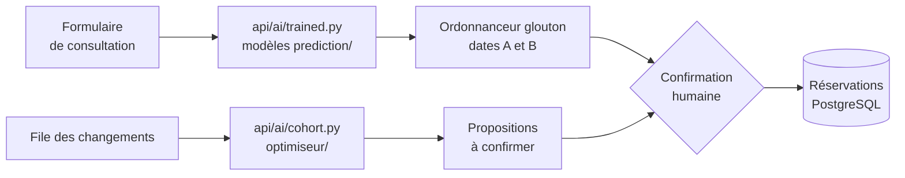

# Intégration de l'IA dans KYST

Cette page décrit comment les composants de recherche, [modèles de prédiction](modeles-prediction.md) et [métaheuristiques](../optimiseur/README.md), sont branchés dans l'application web, et ce que cette intégration ne garantit pas. Les fonctionnalités vues par l'utilisateur sont décrites dans [Fonctionnalités](../interface/docs/Features.md).

## En résumé

- **Nouvelle demande** : à la consultation, KYST appelle les modèles de temps de salle et de séjour, puis propose les dates A et B avec un ordonnanceur glouton rapide, qui contrôle la vacation, les lits pendant tout le séjour et la marge d'urgence.
- **Cohorte** : le cadre de bloc peut optimiser ensemble les demandes en attente avec le recuit simulé, meilleure des dix métaheuristiques au banc d'essai à temps égal (voir plus bas), prévisualiser le résultat, puis le publier sous forme de propositions. Chaque chirurgien confirme ensuite sa demande, avec un nouveau contrôle de capacité.
- **Adaptation** : les modifications de demandes, refus de dates, annulations et changements de ressources entrent dans une file persistante qui actualise les propositions. Les interventions confirmées ne bougent jamais automatiquement : un conflit est signalé au cadre.



Les modèles restent séparés de l'ordonnancement par les interfaces de `interface/api/ai/contracts.py`.

## Utilisation

Le cadre de bloc voit les panneaux suivants sur la page **Bloc** :

1. **Actualiser les propositions après un changement** : nombre de changements depuis le dernier calcul, mode (manuel ou automatique), relance manuelle et historique des derniers calculs.
2. **Optimiser toutes les demandes en attente** : prévisualisation des demandes en attente sur une fenêtre de 60 jours au plus (50 demandes au plus). Les vacations déjà réservées, les lits occupés et les capacités sont lus en base. Le résultat montre les affectations réalisables et les demandes non placées. **Publier des propositions** relance le calcul, revérifie demandes, vacations et lits, puis crée les propositions en une transaction. La publication ne réserve aucune capacité ; chaque confirmation verrouille les ressources dans PostgreSQL et revérifie la faisabilité.

Si un changement de ressources compromet des réservations confirmées, le panneau **Interventions confirmées à revoir** liste les demandes concernées et les raisons, pour que le cadre organise leur révision.

## Actualisation des propositions

Les changements et l'historique des calculs sont enregistrés en base (tables `PlanningChange` et `ReplanRun`). Un calcul réussi remplace les propositions de la cohorte, y compris en retirant les dates devenues impossibles ; un échec conserve les propositions précédentes. Les refus de dates sont respectés jusqu'à la modification des données cliniques de la demande. L'actualisation et la cohorte utilisent toutes deux le **recuit simulé**, sans choix possible. Sur le banc d'essai à temps de calcul égal (300 patients, 80 vacations, 20 graines, 3 s), il obtient le meilleur rang moyen (1,25) et le plus faible écart à la meilleure solution observée (0,015), devant Tabou × Recuit (1,75) ; les systèmes multi-agents et les méthodes à population arrivent derrière. Les autres méthodes restent dans [`optimiseur/`](../optimiseur/README.md) pour la recherche.

Le traitement automatique se règle dans `interface/kyst.env` :

```text
AUTO_REPLAN_ENABLED=true
REPLAN_HORIZON_DAYS=14
REPLAN_BUDGET_SECONDS=1
REPLAN_MAX_CASES=200
```

L'API doit alors tourner avec **un seul processus**. Toutes les deux secondes, le traitement regroupe les changements en attente et relit la base ; ceux qui arrivent pendant un calcul attendent le suivant. Après un redémarrage, un calcul interrompu est signalé et remis en attente. Seul le type d'erreur est enregistré.

## Configuration

Les prédictions viennent toujours des modèles entraînés, lus dans `ROOM_MODEL_PATH` et `LOS_MODEL_PATH`, en local comme en déploiement. L'API, le seed et le dev local en ont donc besoin. Seuls les tests de l'API s'en passent : ils utilisent des prédicteurs de substitution (`interface/api/tests/predictors.py`).

En local, placer les fichiers de `artifacts/ml-models/final-2026-10-20-v3/` (non versionnés, voir [experiments/](../experiments/README.md)) et définir dans `interface/kyst.local.env` :

```text
ROOM_MODEL_PATH=/chemin/absolu/artifacts/ml-models/final-2026-10-20-v3/room_consultation_selected_2026-10-20_v1.joblib
LOS_MODEL_PATH=/chemin/absolu/artifacts/ml-models/final-2026-10-20-v3/los_consultation_selected_2026-10-20_v1.joblib
```

En déploiement, le rôle Ansible [`kyst`](../interface/ansible/roles/kyst/README.md) copie ces deux fichiers sur le serveur et les monte en lecture seule dans `/srv/models`. Un fichier manquant empêche l'API de démarrer, avec une erreur explicite. Aucun modèle ni aucune donnée patient n'entre dans Git ou dans l'image Docker. Chaque prédiction enregistrée garde la version du modèle qui l'a produite (empreinte du fichier).

Le formulaire fournit âge, sexe, diagnostic principal, actes CCAM et type d'intervention, soit exactement les variables des modèles « consultation ». Un séjour prédit de moins de 1,5 jour est classé ambulatoire.

## Limites

- **Précision** : les modèles sous-estiment les longues interventions et les longs séjours, et le modèle de séjour ne bat pas la médiane par type d'intervention (voir [les modèles](modeles-prediction.md#limites)). Les bornes P80/P95 du temps de salle ne sont pas affichées.
- **Optimisation** : l'optimiseur de vacations a une fonction de coût souple et des lits agrégés. L'adaptateur impose ensuite fenêtres, chirurgiens, unités de lits et capacités : il peut laisser des demandes non placées. Intégrer ces contraintes à la recherche elle-même reste à faire.
- **Concurrence** : les verrous de confirmation s'appliquent à PostgreSQL ; SQLite ne sert qu'au développement local.

KYST est un démonstrateur de recherche intégré, pas un déploiement clinique validé.

## Vérification

- API : `cd interface/api && just test` (43 tests : publication, confirmation, invalidation après modification clinique, refus, retrait des propositions impossibles, échec conservant les propositions, reprise et traitement automatique de la file, trace d'accès).
- Moteurs : `python -m unittest discover -t . -s tests` depuis la racine (voir [tests/](../tests/README.md)).
- Front : `cd interface/app && pnpm check && pnpm build`.
- PostgreSQL : `interface/api/tests/check_postgres_concurrency.py` vérifie que deux confirmations simultanées pour le dernier lit donnent une acceptation, un rejet et une seule réservation. Il exige une base vide nommée `kyst_disposable_test`, marquée explicitement comme base de test.
