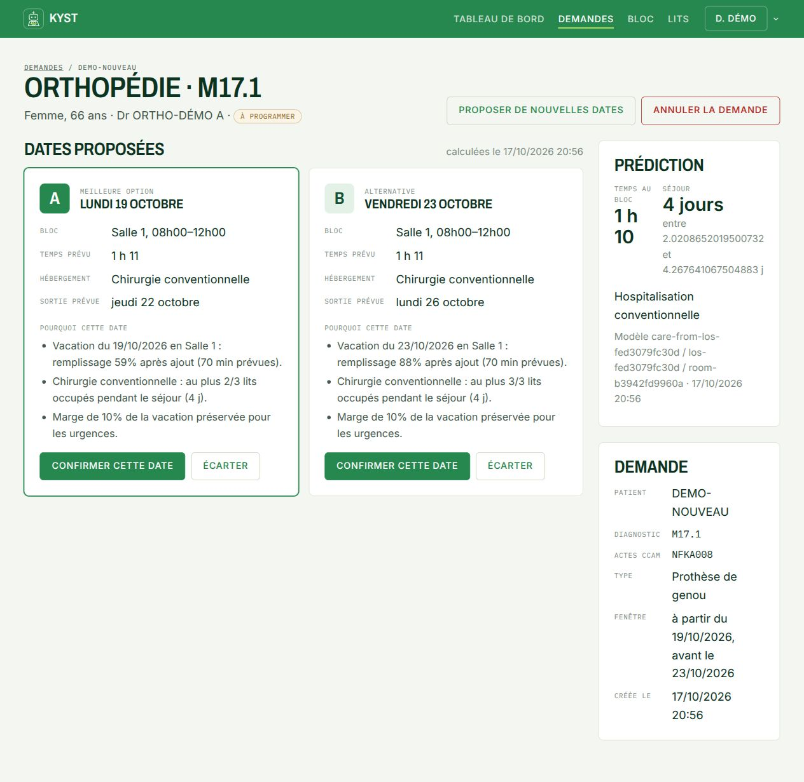
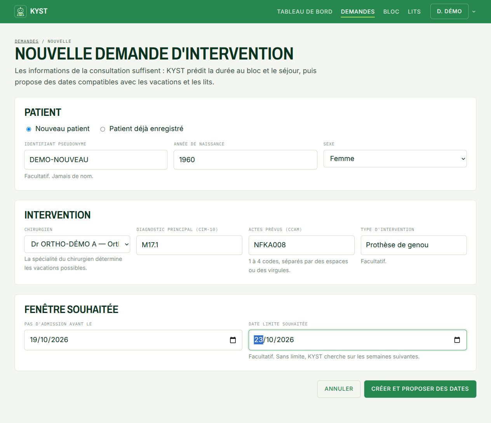
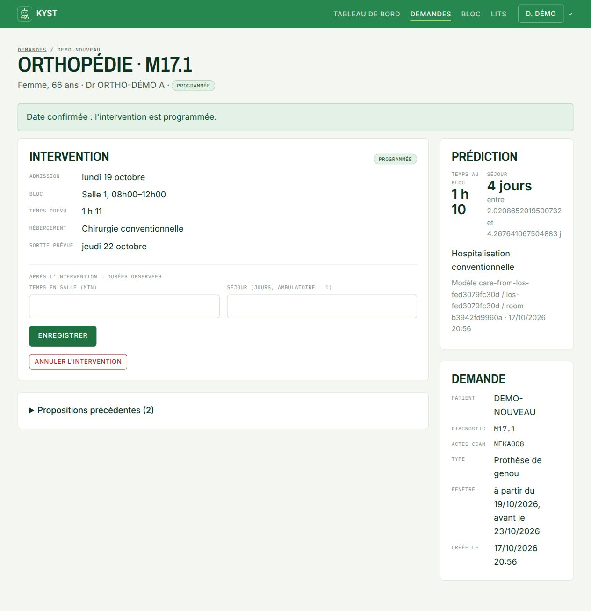
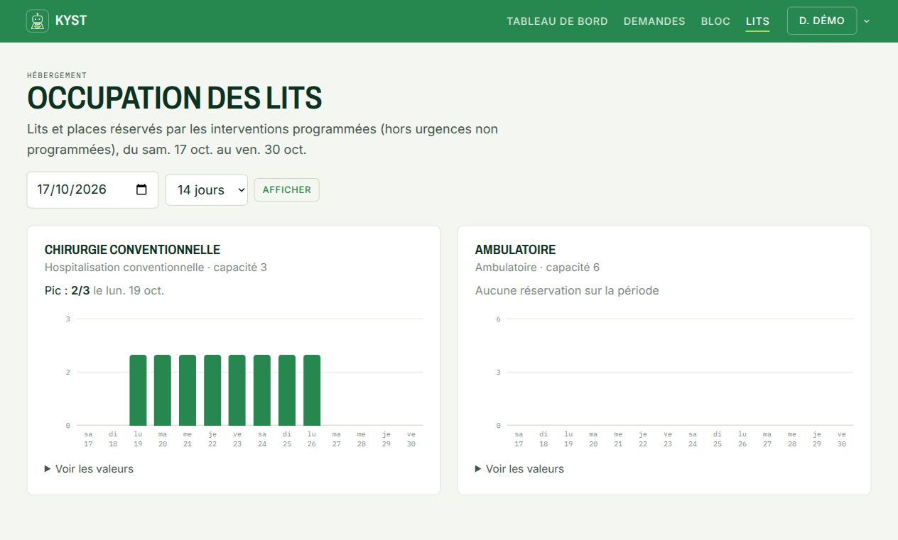
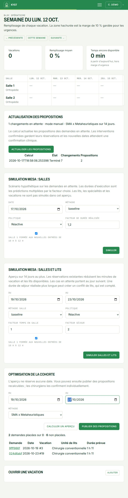
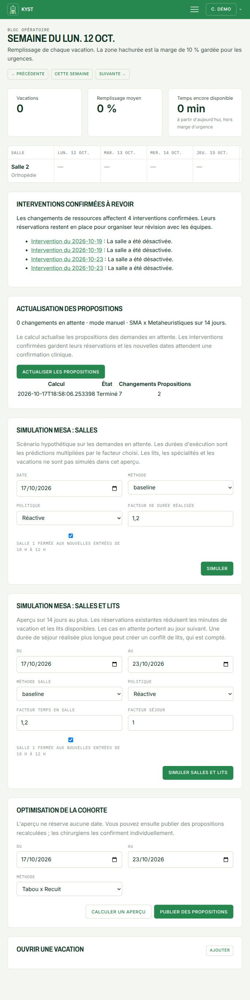
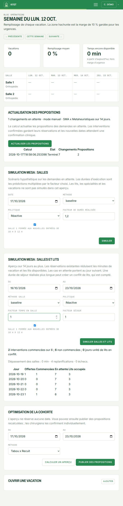
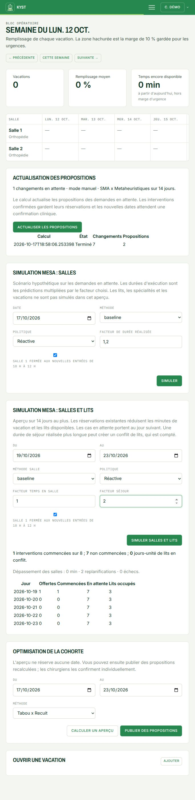

# KYST: five illustrated user stories

Real screenshots of the local application, using an isolated synthetic database.

English guide with the application’s French labels. Captured on 17 October 2026. All people and patient references in the images are synthetic.

## The user journey

Consultation details → ML predictions → feasible dates / cohort optimization → clinical confirmation → reservations → resource review. Mesa provides separate what-if previews.

## 1. Give a new patient two explained dates

**Surgeon.** As a surgeon, I want room-time and length-of-stay estimates from the consultation details, so that I can discuss feasible dates with the patient.

**Actions:** Open Nouvelle demande; enter a pseudonym, birth year, sex, surgeon, diagnosis, CCAM code, procedure type and requested date window; choose Créer et proposer des dates.

**Observed result:** DEMO-NOUVEAU receives Monday 19 October and Friday 23 October. Each option explains room load, bed availability throughout the predicted stay, and the 10% vacation margin.

**Interpretation:** The prediction is about 70 minutes and a four-day stay. A date proposal uses 71 rounded minutes. These are estimates of room occupancy, including more than the surgical act alone.

*Two possible dates with capacity explanations and the trained-model prediction. Full capture; the HTML and PDF focus on the relevant panel.*

*Consultation input form with synthetic details.*

## 2. Confirm a date and reserve the stay

**Surgeon / bed manager.** As a surgeon, I want to confirm one proposed date, so that the room capacity and beds for the predicted stay are reserved together.

**Actions:** Review Date A and select Confirmer cette date. Then open Lits to inspect the resulting occupancy forecast.

**Observed result:** The request becomes Programmée for 19 October, with a predicted last occupied day of 22 October. In this demo, conventional occupancy rises from one to two beds on those four days.

**Interpretation:** Confirmation rechecks current capacity. A proposal by itself creates no reservation. Observed room time and stay can be recorded after surgery; recording them does not automatically retrain the models.

*The confirmed intervention, its predicted stay and fields for later observed outcomes. Full capture; the HTML and PDF focus on the relevant panel.*

*The Lits screen now shows 2/3 conventional beds occupied on 19-22 October.*

## 3. Plan a cohort, then publish proposals

**Operating-room planner.** As a planner, I want to optimize pending requests together, so that shared room and bed constraints are considered across the cohort.

**Actions:** In Bloc, set 19-23 October under Optimisation de la cohorte; choose SMA x Metaheuristiques; calculate an overview, then select Publier des propositions.

**Observed result:** The combined engine places two of eight pending requests; six remain unassigned. Publication recalculates and checks capacity, then publishes two proposals awaiting clinical confirmation.

**Interpretation:** Confirmed cases are preserved. Unassigned cases remain visible. Published proposals are still provisional and do not reserve beds or room time.

*Preview: two assignments and six unassigned requests. Full capture; the HTML and PDF focus on the relevant panel.*

*Publication: two proposals, each awaiting clinical confirmation. Full capture; the HTML and PDF focus on the relevant panel.*

## 4. Respond to a change in room availability

**Operating-room planner.** As a planner, I want resource changes to trigger a review of pending proposals and highlight affected confirmed cases, so that the team can respond to a disruption.

**Actions:** In Ressources, deactivate Salle 1. Return to Bloc, inspect Interventions confirmées à revoir and select Actualiser les propositions.

**Observed result:** Four confirmed interventions are flagged because their room is unavailable. The refresh completes and updates two pending proposals; the queue returns to zero pending changes.

**Interpretation:** Confirmed reservations remain in place for team review. The refresh does not automatically relocate confirmed operations. This demo uses manual refresh; a background worker is optional.

*The four affected confirmed interventions require review. Full capture; the HTML and PDF focus on the relevant panel.*

*The completed refresh reports two updated proposals. Full capture; the HTML and PDF focus on the relevant panel.*

## 5. Test the impact of longer hospital stays

**Planner / research team.** As a planner, I want to test a hypothetical scenario before changing the live plan, so that I can see whether beds or room capacity limit admissions.

**Actions:** Use Simulation Mesa : salles et lits for 19-23 October. Keep baseline, Réactive, room factor 1 and the 10:00-12:00 closure. Compare stay factor 1 with stay factor 2.

**Observed result:** With the same eight pending cases and four confirmed bookings, factor 1 starts two cases and leaves six unstarted. Factor 2 starts one and leaves seven unstarted. Both report zero bed-conflict days and zero solver failures.

**Interpretation:** These are hypothetical execution durations derived from predictions. They are not observed patient outcomes, oracle forecasts, or a comparison proving that one solver is best. Simulation creates no bookings.

*Stay factor 1: two started; six unstarted; four replans. Full capture; the HTML and PDF focus on the relevant panel.*

*Stay factor 2: one started; seven unstarted; two replans. Full capture; the HTML and PDF focus on the relevant panel.*

## Scope and interpretation

The immediate A/B suggestions use the fast individual scheduling path. The cohort action calls the selected optimization engine. Mesa evaluates hypothetical execution separately. Trained predictors were enabled for these captures; their accuracy and uncertainty still need calibration for the reduced web input fields. The multi-day web preview is limited to 14 days and 30 cases, with simplified room calendars. These examples demonstrate implemented workflows; they are not clinical validation or the historical benchmark campaign.

### Capture notes

- English explanations; original French application labels.
- Two synthetic rooms, three conventional beds and six ambulatory places.
- Eight pending requests and four confirmed bookings after the consultation example.
- The multi-day preview simplifies room calendars and uses hypothetical execution factors.
- After a calculation, some app forms reset their controls. Where shown with results, the submitted settings were re-entered for readability without rerunning or changing the results.

Source version: `codex/web-full-system` at `a63560c2962a05f078281eb61a1d6117e3634237`.
