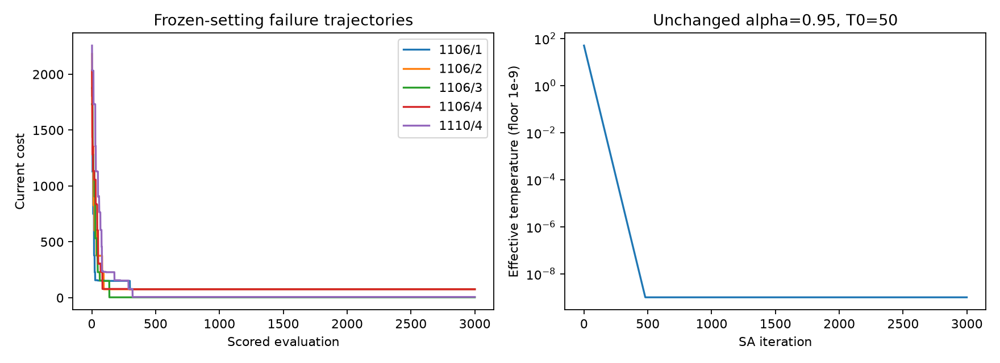
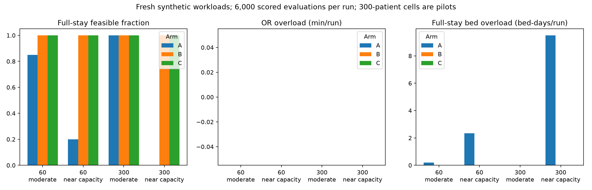
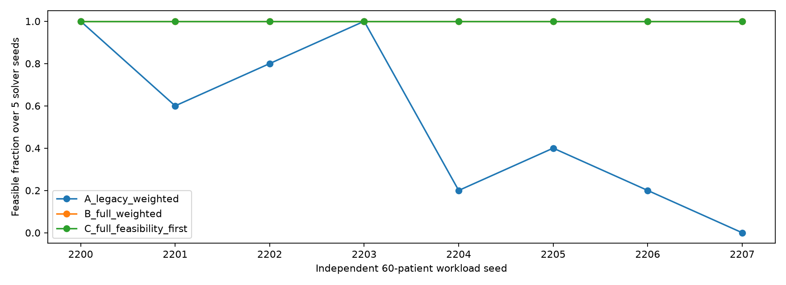

# S1/S2 implementation review and fresh-workload validation

Review date: 19 October 2026. Worktree: `IA-et-Sante-improvements`, branch `improvement/technical-audit`, baseline `a35efde96adaaef96449ddc18918894f9c654eae`. This contribution evaluates the optional research implementation; it does not integrate it into the API/frontend, change historical defaults, tune evaluation instances, retrain models, or alter the scientific article.

## Decision and scope

The float feasibility-first formulation is mathematically sound for the stated complete-assignment problem and normal finite hospital-scale minute/count inputs. It is not a proof that SA will discover a feasible schedule. The fresh 60-patient comparison returned feasible schedules in **21/40 runs for A and 40/40 each for B/C**. The bounded 300-patient pilot returned **2/4 for A and 4/4 each for B/C**. This confirms a useful full-stay accounting effect in these constructed workloads, but **does not establish an additional feasibility-rate advantage from S1 over S2**. The original counterexample still justifies offering feasibility-first ranking as a correctness policy.

The review found and corrected one concrete input-validation defect: unordered/mapping bed supply could be accepted as a vector. It also confirmed integration incompatibilities that prevent treating the subclass as a universal replacement for `PlanningProblem`. Recommendation: ready for teammate review as an **opt-in research PR**, with the mixed/limited evidence retained; not ready for automatic API/frontend exposure or a default switch.

The original 16-patient campaign, its source snapshots, logs and output hashes remain unchanged. New failure diagnostics and larger workloads have separate result directories. The only change to the S1/S2 optimizer/validator implementation is the capacity-input type guard in `optimiseur/validation.py`; `optimiseur/feasibility.py`, the original SA, and shared search control are unchanged.

## Implementation review

### Objective scaling and classification

Feasible cost is `0.05*std(load)/(1+0.05*sum(duration))`; infeasible cost is `1+5*OR_overload+3*bed_overload`. Because nonnegative session loads have standard deviation bounded by their sum, every feasible cost is below one. Every positive capacity overload produces a cost above one at ordinary numeric scales. Complete coverage, allowed options and specialty compatibility are checked before scoring. Invalid assignments raise or return `valid=False, feasible=False`; they cannot obtain a good score merely by omitting patients.

This is a valid **ranking**, but not neutral SA scaling. Larger total duration further compresses feasible balance differences, while infeasible differences retain weighted minute/bed-day units. The fixed `T0=50, alpha=0.95` has very different acceptance behavior for these quantities. Reusing those settings gives a controlled frozen-policy assessment, not evidence that temperature is well calibrated for 60 or 300 patients. No setting was changed to improve the observed outcomes.

The separate feasible incumbent tracks all evaluated candidates, not only the accepted trajectory. Final plans and saved feasible incumbents receive an independent calendar-loop check. Weighted arms can discover a feasible candidate and still return an infeasible weighted best; this difference is explicitly reported. All-zero durations/empty workloads and very restrictive options are supported by the tested contracts. No explicit deferrals, repair, priority objective or new case-dropping behavior is introduced.

The exact-zero overload rule is deliberate. Real API durations are rounded to integer minutes upstream. Fractional floating-point durations close to a hard boundary can create tiny round-off violations; a future public contract should specify minute rounding rather than introducing an undocumented tolerance. Extreme magnitudes that overflow sums/standard deviations are outside the evaluated numeric domain; this review does not certify arbitrary IEEE-754 inputs or unbounded calendars. These are limitations, not explanations of the five integer-data failures.

### Confirmed bug and minimal correction

Before the correction, `checked_inputs` called `tuple(bed_capacities)` without rejecting mappings. Supplying `{2: 0, 3: 0}` consumed the keys as capacities `(2, 3)` and incorrectly labeled the counterexample assignment feasible. A set was also accepted despite its lack of a day-order contract.

The correction rejects `collections.abc.Mapping` and `Set` before vector conversion. Ordered lists, tuples, NumPy arrays and other ordered iterable values retain previous behavior. No capacity is inferred from dictionary values or guessed calendar keys. Both the constructor and independent validator fail closed on these inputs. The old source snapshot was loaded read-only to reproduce the false-positive classification before comparing the corrected code.

Evidence: [confirmed_bug.json](results/s1-s2-review-audit-2026-10-19-v1/confirmed_bug.json). Original validator SHA-256 is `4f471b48f104e21538b2a72cea5d023ab5f3564aa6a41ff0b1bb9da11f4a6e0e`; corrected SHA-256 is `7f13c5ada9cdcafe372cbf8aa251640637e6c7e34be5410b2547dd259cb107ac`. The original campaign supplied ordered lists, so this correction does not change its valid-input scores or outcomes. Its historical snapshots are intentionally not rewritten.

### Full-stay input contract

The bed vector covers at least the latest possible discharge day across each patient's allowed sessions, and includes every intermediate calendar day. `duree_sejour=0` occupies the surgery day; offset k occupies k+1 days. The bed horizon is separate from `n_days`, the surgery-session horizon. Longer explicitly supplied vectors are accepted, short/negative/nonfinite/fractional vectors rejected. Existing commitments must be deducted by the caller to yield residual capacity; this module does not reconstruct a ward census or invent future supply.

The independent checker uses direct per-patient calendar iteration, not the optimizer's difference-array occupancy. Both share input checks; the arithmetic oracle is independent, while the mapping bug was a shared boundary defect. This is why separate edge-case review adds value beyond simply rerunning the same fixtures.

## Diagnosis of the five original failures

[Failure diagnostics](results/s1-s2-failure-diagnostics-2026-10-19-v1/manifest.json) wrap the existing SA's `neighbor`/`fitness` calls, with no additional random draws and no changed temperature, initial assignment, solver seed, budget or move policy. All five replays produced exactly the original saved final best assignments after 3,000 evaluations. Each proposal/current-state trajectory is saved as CSV; checkpoint assignments and local neighborhood diagnostics are saved in `diagnostics.json`.

| Workload / solver seed | Initial OR / bed overflow | Final OR / bed overflow | First evaluation of final best score | Improving one-move neighbors | Feasible one-move neighbors | Feasible distinct states within two moves |
|---|---|---|---:|---:|---:|---:|
| 1106 / 1 | 375 min / 1 day | 15 min / 0 | 298 | 0 | 0 | 0 |
| 1106 / 2 | 435 min / 2 days | 15 min / 0 | 93 | 0 | 0 | 0 |
| 1106 / 3 | 345 min / 2 days | 0 min / 1 day | 137 | 0 | 0 | 1 |
| 1106 / 4 | 405 min / 3 days | 15 min / 0 | 296 | 0 | 0 | 0 |
| 1110 / 4 | 450 min / 2 days | 0 min / 2 days | 319 | 0 | 0 | 0 |

The enumeration includes every legal nontrivial single relocation and same-specialty allowed swap, not just sampled neighbors. Around the returned final best states it checks 91–95 distinct one-move neighbors and 3,656–4,008 distinct two-move states. None hit the 20,000-check diagnostic bound. These are local statements, not global infeasibility certificates.

Confirmed cooling behavior: after 250 iterations, nominal temperature is about `0.000134856`; by iteration 481 the effective temperature is at the existing `1e-9` floor. No replay accepted a nontrivial worsening proposal after evaluation 250. Approximately 21–23% of proposals were self-loops. Extending the evaluation count with unchanged geometric cooling mostly adds nearly greedy/plateau exploration, not sustained annealing.

An additional exhaustive path check evaluates **every two-move path**, rather than only one path to each deduplicated destination. For 1106/3, the minimum first-step cost increase among feasible two-move routes is **150**. The route exists, but it requires a substantial temporary worsening at a nearly frozen temperature. For 1110/4, an improving two-move route requires at least **72** first-step cost increase and still does not complete feasibility. No improving two-move destination was found for 1106/1, /2 or /4. Evidence: [two_move_barriers.json](results/s1-s2-review-audit-2026-10-19-v1/two_move_barriers.json), containing 8,273–8,985 path checks per failure.



**Confirmed conclusions:** these are discovery failures; a feasible candidate was never evaluated in those runs. Local optima/plateaus and rapid loss of uphill exploration are directly observed. The allowed-assignment graph is connected by sequential single-patient relocations if infeasible intermediate states are allowed, so this is not a proof of absolute neighborhood disconnection. Good paths may require more than two moves or longer plateau walks.

**Hypotheses still unproved:** how much a different random initial plan, a slower schedule, or a capacity-aware repair would improve aggregate success. Different starting plans across the existing solver seeds have different outcomes, but initialization and subsequent random draws are not independently factorialized. The witness was not used to guide a new solution. No parameter was tuned on 1106 or 1110, and none of the new evaluation workloads should now become a hidden tuning set.

## Fresh larger-workload protocol

The new campaign is in [s1-s2-generalization-2026-10-19-v1](results/s1-s2-generalization-2026-10-19-v1/), driven by `experiments/review_feasibility.py`. The script and manifest were frozen before evaluation outcomes were inspected.

- **60-patient primary comparison:** independent workload seeds 2200–2207, four moderate-demand and four near-capacity workloads; five solver seeds each, three arms: 120 planned primary runs.
- **300-patient pilot:** new seeds 3300/3301 for moderate/near-capacity, two solver seeds each if practical; at most 12 pilot runs.
- Both sizes use exactly the same three score/accounting arms as S1/S2, uniform eligible starting assignments shared across arms, and solver seeds. No planted witness is passed to the search or used as a starting plan.
- 60 cases span five operating days × three specialty sessions (four witness cases/session). 300 cases span 20 days × three sessions (five witness cases/session). Synthetic durations follow a clipped/rounded lognormal variation from 15–180 minutes. LOS offsets mix same-day discharge and offsets 1, 2, 3, 5 and 7. These distributions are plausible variations, not estimates fitted to hospital data.
- Approximately 25% of cases have restrictive three-day eligibility windows containing their witness date; the others can use any same-specialty session. Restrictions are generated for both pressure groups, not added only when an algorithm struggles.
- OR capacities are witness loads divided by a target 0.80 or 0.95 utilization, rounded up to 15 minutes. Explicit bed capacities follow witness occupancy divided by the same target, rounded up, with one extra bed/day in moderate cases. Complete future tail vectors are saved, including any explicit zero supply. Thus the witness proves modeled feasibility, while the generated capacity structure remains artificial.
- Each arm receives **6,000 scored evaluations including initialization**, unchanged `T0=50`, `alpha=0.95`, with rotating arm order. This is 100 evaluations/patient at 60 and only 20 at 300. The pilot is not an asymptotically fair convergence study across sizes.
- Per-run search guards: 15 seconds at 60 cases, 20 seconds at 300. The campaign has a 900-second total guard checked before matched three-arm blocks. Pilot early-stop checks avoid continuing after an expensive or deadline-censored block; skipped blocks are recorded without replacement seeds or retuning.
- Every returned plan and saved feasible incumbent is independently validated through discharge. Final feasibility and any-feasible discovery are separate outcomes. Deadline-censored runs retain actual evaluation counts and cannot be treated as complete equal-budget results.

### Larger-workload results

All **132 planned runs completed**, including the full bounded 300-patient pilot, in 486.18 seconds of campaign wall time. There were no skipped blocks or deadline stops. Every run used 6,000 evaluations, totaling **792,000** (720,000 for the 60-patient primary comparison plus 72,000 for the pilot). Every final assignment had complete coverage and valid options. All 21 physically infeasible final schedules belonged to A; they had bed-tail overload, not malformed assignments.

| Patients / demand | Workloads × solver seeds per arm | A: feasible returned / discovered | B: returned / discovered | C: returned / discovered |
|---|---:|---:|---:|---:|
| 60 / moderate | 4 × 5 | 17/20 / 20/20 | 20/20 / 20/20 | 20/20 / 20/20 |
| 60 / near capacity | 4 × 5 | 4/20 / 16/20 | 20/20 / 20/20 | 20/20 / 20/20 |
| 300 / moderate pilot | 1 × 2 | 2/2 / 2/2 | 2/2 / 2/2 | 2/2 / 2/2 |
| 300 / near-capacity pilot | 1 × 2 | 0/2 / 0/2 | 2/2 / 2/2 | 2/2 / 2/2 |

This distinction matters: on the 60-patient workloads, A **discovered** a full-stay feasible candidate in 36/40 runs but **returned** one in only 21/40. Keeping A's independently checked feasible incumbent would recover 15 runs without changing its search trajectory. B/C still discover feasibility in four runs where A never does. At 300 cases, the two near-capacity A runs never discover a feasible candidate. Thus the accounting intervention affects both trajectory and best-plan selection; the entire final-feasibility difference must not be described as better search discovery.

| Patients / demand | Mean OR overload, A / B / C (min/run) | Mean full-stay bed overload, A / B / C (bed-days/run) | Mean search time, A / B / C (s) |
|---|---|---|---|
| 60 / moderate | 0 / 0 / 0 | 0.20 / 0 / 0 | 3.17 / 4.42 / 4.57 |
| 60 / near capacity | 0 / 0 / 0 | 2.35 / 0 / 0 | 0.91 / 1.27 / 1.27 |
| 300 / moderate pilot | 0 / 0 / 0 | 0 / 0 / 0 | 2.44 / 3.93 / 3.71 |
| 300 / near-capacity pilot | 0 / 0 / 0 | 9.50 / 0 / 0 | 2.66 / 4.35 / 4.47 |

All A bed overload occurs **after the final operating-session day**: 4 bed-days total for the moderate 60-patient group, 47 for the near-capacity 60-patient group, and 19 for the 300-patient near-capacity pilot. The unchanged truncated capacity check calls all these final plans feasible; the independent full-stay checker correctly rejects them. This is direct evidence that ignoring the tail can conceal operational demand on larger assignments.



No arm has final OR overload in this new campaign. The empty/zero OR panel is intentional: this is chiefly a bed-tail accounting test, not evidence of superiority on difficult OR packing. Capacity pressure is relative to the generated witness, not a measured hospital utilization. B and C both saturate the feasibility endpoint, so the benchmark cannot resolve an incremental S1 benefit. A harder independent OR-packing benchmark would be needed before claiming broad search improvement.

### Workload grouping, quality and failures

The independent workload units are the eight 60-patient seeds and two 300-patient pilot seeds, **not** the 132 repeated arm/solver runs. Compared with A, B/C improve feasible-return rate on six of eight 60-patient workloads and tie on two. B and C tie on all eight. The 300-patient results describe only one workload per pressure group; they do not establish population success rates or a formal scalability law. Different sizes also use different calendars/session counts, so size is not the only changed structural factor.



All new B/C runs discover and return feasible schedules. A's failures are fully listed in [failure_runs.csv](results/s1-s2-generalization-2026-10-19-v1/failure_runs.csv). Workload 2207 is the worst 60-patient baseline case: zero feasible returns and only 2/5 feasible discoveries, with mean four bed-tail overload days. The 300-patient near-capacity baseline has zero returns/discoveries in two runs and mean 9.5 tail-overload days, despite its saved feasible witness. These are failures under the supplied accounting/search policy, not intentionally infeasible inputs.

Among jointly feasible pairs, C's load-balance standard deviation is slightly worse than B in moderate cases and slightly better near capacity:

| Patients / demand | Jointly feasible B/C pairs | Mean `C balance − B balance` (minutes; negative is better) |
|---|---:|---:|
| 60 / moderate | 20 | +0.0401 |
| 60 / near capacity | 20 | −0.4820 |
| 300 / moderate pilot | 2 | +1.0372 |
| 300 / near-capacity pilot | 2 | −1.4565 |

A can have better balance on the subset where it returns a feasible schedule: matched `C−A` differences are +0.1277 minutes in 17 moderate 60-patient pairs and +1.7605 in four near-capacity pairs. Neither C nor B dominates on soft quality. Pooled means over different feasible subsets are not a fair quality comparison. Per-run best-feasible balance, soft cost, first-feasible evaluation/time, final arm cost and full-weighted diagnostic cost are retained in the raw CSV; unlike scores are not pooled as one objective.

Runtime differences are descriptive. Diagnostics perform full-stay checks in every arm, and B/C add strict/full-stay component evaluation. Per-run `search_seconds` measures the controlled loop; `run_seconds_including_final_validation` includes wrapper/final checks but **excludes construction of the problem before the timer**. It is not a full web-request latency measurement. Mean wrapper times at 300 are 4.21–7.40 seconds across cells, already material relative to current short replanning budgets. Timing drifts markedly across sequential workload groups; diagnostic overlap/system load and ordered pressure blocks prevent treating pressure-specific speed differences as causal. No speedup or real-time readiness is claimed.

The generator produced explicit 10–12-day bed horizons at 60 and 27-day horizons at 300. Actual synthetic session capacities range from 150–690 minutes at 60 and 225–675 at 300. This variation is not a fixed eight-hour-room clinical model. All planted witnesses pass the independent checker; none are used as solver initializations. No new comparison workload was replaced or retuned after observing a failure or success.

The main inference is therefore narrow and useful: **S2's accounting correction generalizes to the tested larger workloads; S1 preserves its mathematical ranking guarantee and shows comparable feasibility here, but its earlier incremental success-rate advantage does not recur in this campaign.**

## Integration readiness

| Boundary | Observed compatibility | Required before exposing a new integrated mode |
|---|---|---|
| Patient/session frames and positional assignment mapping | Compatible; external `patient_id`/`vacation_id` values remain distinct from internal positions | Keep existing adapter mapping; reject malformed/missing options before scheduling |
| `RunResult` output | Wrapped result retains existing shape; richer validation/incumbent metrics are separate | Carry objective/accounting metadata; the plain `nom` is still the generic SA label |
| `optimize_planning` selector | Does not currently construct this subclass or route the new mode | Deliberate optional adapter/selector change and contract tests; do not change defaults |
| Bed plotting | Existing `plot_occupation_lits` uses `n_days` x-axis against full-stay occupancy | Separate bed-horizon axis/capacity metadata before using that plot with this subclass |
| Disruption/alternative-plan helpers | Some reconstruct a plain `PlanningProblem` using the long capacity array, discarding full-stay semantics | Preserve problem mode/horizon when reconstructing; review every clone and avoid mixing scalar-score units |
| Resource model | Research class supports one aggregate residual bed vector and residual session minutes | Per-unit care-type/day feasibility must still be validated; pooled beds cannot prove a consistent unit exists |
| Confirmed bookings | New solver does not ingest clinical DB reservations itself | Deduct booked minutes, emergency margins, and every booked bed day; keep confirmed cases fixed |
| Future supply | Web snapshot reads existing bookings through `end + max_stay - 1`; BedUnit supply is a static current capacity, not a staffed future calendar | Operator-approved future supply/calendar and explicit assumptions; do not repeat today's supply silently |
| Confirmation/publication | Existing per-unit full-stay checks, accepted prediction linkage and PostgreSQL row locking remain authoritative | Revalidate against current state at acceptance, preserve locks/conflict reporting, never bypass human confirmation |
| Runtime limits | Current web replanning is a bounded single-process workflow, typically much shorter than this research campaign | Bounded execution/fallback, cancellation, empty cohort/too-many-cases tests; no implied real-time guarantee |

The plot incompatibility and plain-problem reconstruction failure were reproduced with a synthetic two-day surgery/five-day bed problem, and saved in [integration_probes.json](results/s1-s2-review-audit-2026-10-19-v1/integration_probes.json). They are confirmed limitations of plugging the subclass into old helper code, not changed legacy behavior; this review deliberately does not patch the application or those helpers.

Optional **research** use through `run_validated_sa` is reviewable. Offering it as an API/frontend scheduling option requires a separate adapter change with future capacity, per-unit validation and runtime work. No interface integration is performed here.

## Validation and reproducibility

The final captured regression command ran **139 tests: 138 passed, one skipped**, in 13.128 seconds of unittest time, with actual child exit code zero. The skip is the pre-existing confidential EDA Parquet check. This includes the original relevant optimizer/hybrid/disruption/coordination/bridge/prediction-ward coverage, the 16 initial S1/S2 tests, four review tests and two fresh-generator tests. Generator contract tests use separate smoke seeds 4400–4403, not the evaluation seeds.

The original 180 final schedules and 152 saved feasible incumbents pass the read-only replay under the corrected validator, and their archived output/source hashes still match. The new replay independently checks **132 final schedules and 126 feasible incumbents**, hashes, full coverage, equal complete budgets and matched three-arm blocks. Both replay child processes exit zero. New correctness tests reproduce the mapping/set defect, ordered NumPy supply, nonpositional external identifiers, fixed restrictive assignments and extended stays, plus a 60-patient scalar-score/calendar-oracle check.

The runner and actual exit codes/log hashes are saved in [verification.json](validation/s1-s2-review-2026-10-19/verification.json); logs are [regression.txt](validation/s1-s2-review-2026-10-19/regression.txt), [original_replay.txt](validation/s1-s2-review-2026-10-19/original_replay.txt) and [generalization_replay.txt](validation/s1-s2-review-2026-10-19/generalization_replay.txt). The file-based regression tests used the previously necessary authorized Windows sandbox workaround; bytecode was disabled and caches/temporary files remained in this worktree. No new dependency installation was needed for this review.

Reproduce from the repository root, using **new empty output directories** for experiments:

```powershell
$env:PYTHONDONTWRITEBYTECODE = '1'
python -B -m unittest tests.test_feasibility tests.test_feasibility_experiment tests.test_feasibility_review tests.test_feasibility_generalization -v
python -B -m experiments.diagnose_feasibility_failures --output experiments/results/my-failure-replay
python -B -m experiments.audit_feasibility_review --output experiments/results/my-input-and-barrier-audit
python -B -m experiments.review_feasibility --output experiments/results/my-generalization
python -B -m experiments.review_feasibility --verify-only --output experiments/results/my-generalization
```

`experiments.run_feasibility_checks` reproduces the captured regression/replay checks against the canonical saved directories and accepts a new `--output` validation directory. Set `PYTHONPATH` to a worktree-local dependency directory if using the previously installed Mesa/NetworkX/tqdm packages, or use an environment with the documented repository dependencies. The checks runner automatically uses local `.deps/` when present and captures stdout/stderr with actual process return codes.

Independent replay hashes the archived source copies as well as outputs; code hashes identify the uncommitted implementation actually used, rather than implying the baseline Git HEAD alone contains it. The old snapshot's mapping defect is documented rather than erased. The full API/frontend/container suite and any real-data/model evaluation remain unrun, because this review changes no application interface or trained model.

## Remaining weaknesses and next scientific priorities

1. **Feasibility discovery under restrictive/tight packing:** short-range moves and rapidly frozen uphill acceptance can prevent finding a known feasible schedule. This is stronger motivation for a capacity-aware constructor/repair ablation than for another complex hybrid. Charge construction/repair runtime and candidate evaluations explicitly, retain a no-repair baseline, and use a new development set plus untouched held-out workloads. Do not initialize with a planted witness.
2. **Operational integration contracts:** aggregate beds, per-unit packing, fixed reservations, future supply, helper reconstruction/plotting and short runtime limits need explicit handling. Research feasibility is conditional on supplied residual resources; it does not establish a clinically valid booking.
3. **Model-to-decision evidence:** this campaign says nothing about whether ML estimates improve realized surgery/bed outcomes. A controlled median-versus-ML replay must use common patients, train eligibility, consultation-time inputs/resources and budgets, and held-out actual outcomes visible only to the evaluator.
4. **Consultation-feature mismatch:** OR model masking/calibration evidence motivates retraining on realistic available features, but that needs artifact/data provenance, independent calibration and downstream validation. Another hyperparameter sweep is not the immediate priority.

| Next option | Scientific value | Evidence and prerequisites | Effort/risk | Recommendation |
|---|---|---|---|---|
| B. Controlled median versus ML | Highest direct value for the project's prediction-to-planning claim | Requires verified artifact/split manifests and controlled decision-time features; hold LOS fixed first to isolate room estimates | Medium/high protocol/data dependency; risk of leakage and confounding | First scientific priority, conditional on a short successful artifact/cohort preflight |
| A. Capacity-aware initialization/repair | Tests the observed discovery bottleneck and may help under shorter operational budgets | Five exact failure replays/local barriers, but all new B/C runs succeed at 6,000 evaluations; use fresh tight-packing/short-budget development and held-out sets | Small/medium experiment with no ML artifact dependency; risk of hidden effort or overfitting known failures | Second scientifically; the more practical deadline fallback if B's prerequisites cannot be verified |
| C. Consultation-feature retraining | Addresses a documented deployment distribution mismatch | Requires authorized datasets/artifacts, validation-selected features and separate recalibration | Medium/high; retrospective test already examined, new model may not improve operational outcomes | Third; do not rush retraining before a sound decision-quality comparison |

The ordering reflects the new evidence: B/C both saturate feasibility on this larger benchmark, so a repair feature cannot yet claim a missing generalization benefit at this budget. A controlled room-median-versus-ML comparison would address a new central scientific question. Begin B with a bounded artifact/split/feature audit, not a training job; artifacts and datasets are not provided in this worktree, and previous context still reports missing LOS fitted evidence. If the preflight cannot be completed promptly, choose a narrowly scoped synthetic A experiment instead. Do not implement repair solely to make 1106 pass. C can then be informed by the decision-quality and missing-feature evidence rather than another model-tuning exercise.

The recommendation is for future selection, not authorization to implement A/B/C in this review. No result should be improved by quietly retuning on an already inspected evaluation workload.

## Reviewable contribution

**Ready for teammate review and a research-scoped pull request:** the code change is isolated, the concrete input defect is corrected, the old campaign remains reproducible, and mixed larger-workload results are saved rather than selected for wins. Keep A/B/C names and the distinction between corrected accounting and improved feasibility discovery in the PR description. A suggested description is in [S1_S2_PR_DESCRIPTION.md](S1_S2_PR_DESCRIPTION.md). No PR is created or published by this task.

**Not ready for integrated scheduling exposure:** do not swap the subclass into every existing caller or change default optimizer behavior. Before API integration, address the explicit future-capacity contract, per-unit packing, fixed bookings/reservations, problem reconstruction, horizon-aware plotting, short deadlines and fallback outcomes. Required future integration tests include concurrent booking revalidation, stale capacity, reduced tail supply, distinct care types/units, confirmed-case preservation, no-compatible-case handling, empty cohorts and timeout behavior.

File changes in this review:

| File | Purpose |
|---|---|
| `optimiseur/validation.py` | Only optimizer/validator correction: reject Mapping/Set bed supply rather than consuming keys or unordered elements |
| `.gitignore` | Exclude nested `matplotlib-cache/` as well as the prior local environment/cache/temp exclusions |
| `tests/test_feasibility_review.py` | Four input/restriction/numeric/representation review regressions |
| `tests/test_feasibility_generalization.py` | Two fresh-generator and equal-start/budget checks using non-evaluation seeds |
| `experiments/review_feasibility.py` | Frozen 60/300 generation, guards, common A/B/C runs, grouped analysis, figures and independent replay |
| `experiments/diagnose_feasibility_failures.py` | Exact no-extra-RNG trajectory replay and bounded one/two-move diagnostics for the five known failures |
| `experiments/audit_feasibility_review.py` | Reproduce archived mapping bug, helper incompatibilities and exhaustive two-step path barriers |
| `experiments/run_feasibility_checks.py` | Capture regression/replay logs with actual child exit codes and hashes |
| `experiments/S1_S2_GENERALIZATION_REVIEW.md` | This review and interpretation |
| `experiments/S1_S2_PR_DESCRIPTION.md` | Reviewable PR text; no publishing action |
| `experiments/COMMIT_FILES.txt` | Exact contribution allowlist, including the uncommitted S1/S2 foundation and supporting synthetic evidence |

The allowlist contains source, tests, both technical reports, manifests, synthetic workload/schedule CSV/JSON evidence, figures, source snapshots required by those manifests and selected final validation logs. It excludes `.deps/`, `.tmp/`, `.cache/`, bytecode, nested `matplotlib-cache/`, earlier failed setup logs, any confidential data/model directory and all sibling-worktree files. Earlier setup logs remain preserved locally. The source snapshots deliberately retain the versions actually evaluated, including the old validator in the old campaign; they are provenance artifacts, not alternate installed packages.

The original `S1_S2_TECHNICAL_REPORT.md` and campaign outputs are unchanged. The contribution also includes the existing uncommitted S1/S2 source/tests and `.gitignore` exclusions from the prior phase; these are listed explicitly rather than assuming they are already on main. Nothing is staged, committed, pushed, merged or deployed by this assessment.
