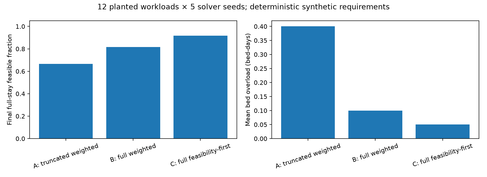
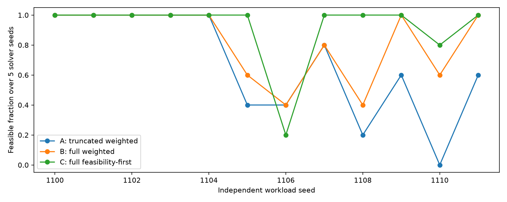

# S1/S2: full-stay accounting and feasibility-first simulated annealing

Implemented and evaluated on 19 October 2026 in `IA-et-Sante-improvements`, branch `improvement/technical-audit`, based on `a35efde96adaaef96449ddc18918894f9c654eae`. This is a synthetic technical experiment, not a new clinical or ML validation. All changes are opt-in. No original algorithm file, web interface, fitted model, dataset, historical result, article, or sibling worktree was modified. No merge, push, deployment or retraining was performed.

## Result and recommendation

The known mathematical counterexample is corrected. Full-stay accounting detects previously hidden bed demand. On 12 planted-feasible synthetic workloads, feasibility-first SA returned full-stay feasible schedules in **55/60 runs**, compared with **49/60** for full-stay weighted SA and **40/60** for the unchanged truncated weighted baseline. Every primary run used exactly 3,000 scored candidate evaluations, including initialization, for **540,000 primary evaluations** in total.

This supports retaining the new mode for reviewed experiments. It does **not** justify changing the default, promising feasibility, or declaring universal dominance. C still failed on five runs with known feasible witnesses and performed worse on workload 1106. The small constructed benchmark is deliberately sensitive to capacity and tail accounting. No temperature retuning, repair or deferral redesign was performed after inspecting results.

Recommended next technical step: inspect workload 1106's local search traps and evaluate a separately labeled capacity-aware initialization/repair ablation on new development workloads. Do not immediately change cooling parameters until the present comparison is frozen. Keep a held-out synthetic evaluation set for any subsequent tuning.

## Implemented contract

The implementation adds `FullStayPlanningProblem`, a strict subclass of the existing `PlanningProblem`, and `run_validated_sa`, which calls the **existing** decorated `simulated_annealing` loop with `SearchControl`. The legacy implementation and entry points are unchanged. This avoids introducing tuple fitness or changing web callers' default behavior.

The full-stay API accepts:

- The same patient and vacation tables and positional assignment indices used by the research optimizer.
- `duree_sejour` as an integer postoperative **offset**: zero occupies the surgery day only; offset k occupies k+1 days including both endpoints. It is not raw total admission-to-discharge LOS.
- An explicit vector of residual bed capacities, including all possible discharge days under the allowed options. Scalar supply and short vectors are rejected. Additional explicitly supplied days are accepted and checked; no tail capacity is inferred or repeated.
- Complete, integer, specialty-compatible per-patient options and assignments. Missing patients, extras, invalid indices, booleans/fractional indices, incompatible options, negative/nonfinite quantities, and invalid capacity vectors fail validation. No implicit patient deferral or specialty fallback is introduced.

`n_days` retains the operating-session horizon. `n_bed_days` is the explicit bed-vector length. The vectorized occupancy implementation extends through actual modeled discharge without clipping at the last surgery day. Capacity represents remaining supply after existing commitments; this implementation does not reconstruct an existing ward census.

The independent validator imports no optimizer occupancy implementation. It iterates directly over each patient's calendar days, accumulates session loads, checks coverage/options/specialties, and reports total and post-operation-window overload. Invalid assignments return `valid=False, feasible=False`; their zero overflow placeholders are not usable capacity estimates. Valid assignments may still be infeasible, and are reported as such rather than silently dropped.

Upstream conversion from total inclusive LOS to postoperative offset remains the responsibility of the existing bridges. Main's corrected patient/date matching and preoperative conversion are preserved. The regression suite includes the existing bridge tests for preoperative days, surgery-day rather than admission-day bed demand, and hidden-outcome invariance. Historical experiments using older semantics are not retroactively corrected.

## Objective and SA scaling

The unchanged weighted cost is:

`5 × OR overload minutes + 3 × bed overload days + 0.05 × std(session loads)`.

The feasibility-first float cost, minimized by maximizing its negative, is:

```text
if OR overload == 0 and bed overload == 0:
    cost = 0.05 * std(session loads) / (1 + 0.05 * sum(patient durations))
else:
    cost = 1 + 5 * OR overload minutes + 3 * bed overload days
```

All valid feasible scores are below 1, while all capacity-violating scores are above 1. Thus no amount of improved balance can make an infeasible assignment win. Among feasible assignments, the score is monotonic in load balance. Among infeasible assignments, it retains the original weighted violation gradient; balance no longer competes with violation reduction. Invalid/incomplete assignments are rejected before scoring.

All arms use `T0=50`, `alpha=0.95` and the existing relocation/same-specialty swap operators. Feasible balance is compressed, so **SA acceptance is rescaled** within and across the feasible boundary; this is explicitly part of the objective intervention. Infeasible cost differences retain original violation units. The first experiment does not isolate every acceptance effect from incumbent selection. It does not claim scale-invariant SA behavior.

A separate best-feasible incumbent is tracked for every arm, including candidates evaluated but not selected as the final weighted best. It is independently checked before being returned. In feasibility-first mode a discovered feasible incumbent cannot be replaced as best by an infeasible candidate, although the search trajectory can still leave the feasible region. This is a preservation property, not a finite-budget discovery guarantee.

The observer computes full-stay diagnostic components for each candidate in every arm. These diagnostics do not propose additional candidates or influence the legacy trajectory. The 3,000-evaluation budget counts scored candidate calls, initialization included, not diagnostic arithmetic; the extra work is included in recorded runtime. Final independent validation is separately included in the end-to-end runtime column.

## Counterexample and correctness gates

Two patients each need 1,000 minutes and have same-day discharge. There are two 2,000-minute sessions on days 0 and 1. Patient 0 must use day 0; patient 1 can use either. Bed capacities are `[2, 0]`.

| Assignment | Full-stay status | Original weighted cost | Feasibility-first cost |
|---|---|---:|---:|
| Both on day 0 | Feasible, loads `[2000, 0]` | 50 | 0.4950495 |
| Split between days 0 and 1 | One bed-day overload, loads `[1000, 1000]` | 3 | 4 |

The original objective prefers the invalid plan; the new objective prefers the feasible plan. This is saved in [counterexample.json](results/s1-s2-2026-10-19-v1/counterexample.json).

A separate regression sets a final-day patient's offset to 3: it occupies days 1–4. With beds `[2, 2, 0, 0, 0]`, the original two-day accounting reports zero overflow and cost zero for the balanced assignment. Full-stay accounting and the direct calendar validator both report **three post-horizon bed-overload days**, with weighted cost 9.

The new tests also check same-day discharge, invalid capacity vectors, specialty incompatibility, missing/extra/invalid assignments, loss of a feasible incumbent by weighted ranking, all-feasible-versus-infeasible ranking on a tiny enumeration, an independent randomized calendar comparison, empty workloads, invalid search settings, fixed-seed determinism, equal starts and evaluation budgets, and exact baseline trajectory preservation under the controlled-search wrapper.

## Experimental protocol

The complete inputs are saved in [workloads.json](results/s1-s2-2026-10-19-v1/workloads.json), and protocol/source hashes in [manifest.json](results/s1-s2-2026-10-19-v1/manifest.json).

- 12 workload seeds, 1100–1111; four slack, four near capacity, four with declining tail bed supply.
- Each workload has 16 patients, eight operating sessions, four operating days and two specialties. Durations are synthetic multiples of 15 minutes. Postoperative offsets range from 0–2 in the first eight workloads and 1–3 in the tail group.
- A feasible assignment is planted at generation time and checked independently. OR capacity is its session load plus 180 minutes in the slack group or 15 minutes otherwise. Beds derive from its occupancy with the declared slack; tail workloads use high operating-day supply and lower witness-based tail supply. The witness is saved for verification but is not passed to initialization or search.
- Five solver seeds per workload, 0–4. Initial assignments are generated separately from the witness and reused in all arms. Both specialties have four compatible choices for each patient.
- A: unchanged weighted scoring with legacy truncated occupancy. B: weighted scoring with full-stay occupancy. C: full-stay feasibility-first scoring.
- Existing SA, identical T0/alpha/moves, 3,000 scored evaluations per run including initialization. No repair or extra warm start. Arm order rotates to reduce fixed-order bias.
- A 30-second per-run evaluation-boundary safety guard was available; no run reached it. This is not process-level hard preemption.
- All arms' final schedules and best-feasible incumbents are checked using the same independent full-stay validator. No incomplete assignment is accepted.
- Four infeasible stress fixtures are separate: missing compatible specialty (rejected before search), a patient longer than every allowed session, aggregate forced-session overload, and mandatory bed overload. The three representable fixtures are exactly enumerated and run in all three arms, giving nine additional 3,000-evaluation stress runs. None is mislabeled feasible.

All durations and stays in this experiment are exact synthetic requirements. Assignment count is not called completed surgery count. There is no minute-level execution, uncertain actual duration, ML inference, hospital staffing model or prospective patient outcome in this campaign. Operational outcomes here mean complete assignability within OR capacity and bed availability through modeled discharge.

## Primary results

| Metric | A: legacy weighted | B: full weighted | C: full feasibility-first |
|---|---:|---:|---:|
| Full-stay feasible final schedules | 40/60 (66.7%) | 49/60 (81.7%) | 55/60 (91.7%) |
| Found any feasible candidate | 48/60 | 49/60 | 55/60 |
| Invalid/missing final assignments | 0 | 0 | 0 |
| Mean OR overload, min/run | 2.00 | 1.75 | 0.75 |
| Mean full-stay bed overload, bed-days/run | 0.400 | 0.100 | 0.050 |
| Mean tail bed overload, bed-days/run | 0.383 | 0.033 | 0.033 |
| Final plans legacy capacity check would call feasible but full check rejects | 12 | 2 | 1 |
| Median evaluation to first feasible, conditional on finding one | 87.5 | 92 | 108 |
| Mean search time, s | 0.894 | 1.083 | 1.071 |
| Mean run time including final validation, s | 0.990 | 1.181 | 1.173 |
| Evaluations per primary run | 3,000 | 3,000 | 3,000 |
| Deadline stops | 0 | 0 | 0 |

Raw rows are in [runs.csv](results/s1-s2-2026-10-19-v1/runs.csv); [summary.csv](results/s1-s2-2026-10-19-v1/summary.csv) retains precise values. Final schedules and independent occupancy/load diagnostics are in [schedules.jsonl](results/s1-s2-2026-10-19-v1/schedules.jsonl).

Across A's final plans, bed overload totals 24 bed-days, of which 23 occur after the operating-session horizon. B reduces this to 6/2 and C to 3/2. The tail defect therefore has a direct measured impact on this constructed benchmark. A found a feasible candidate in 48 runs but returned one in only 40; simply recovering its feasible incumbent would already reduce part of the observed gap. C's comparison against this stronger diagnostic is 55 versus 48, rather than 55 versus 40. No claim attributes the entire gain to better discovery.



## Workload-level comparison and negative results

The 60 repeated solver runs are **not 60 independent hospital workloads**. The experimental unit for workload variation is one of 12 synthetic workload seeds. Paired workload-level feasible-rate differences are saved separately in [paired_workload_differences.csv](results/s1-s2-2026-10-19-v1/paired_workload_differences.csv).

| Comparison | Better workload feasible rate | Worse | Equal | Mean rate difference over 12 workloads |
|---|---:|---:|---:|---:|
| B versus A | 5 | 0 | 7 | +15 percentage points |
| C versus B | 4 | 1 | 7 | +10 percentage points |
| C versus A | 6 | 1 | 5 | +25 percentage points |

The B–A ablation shows an improvement due to accounting alone. C–B adds a benefit beyond that accounting correction, but on only four improved workloads and with one worse workload. These differences are descriptive. No population confidence interval, p-value or general-superiority claim is made.

All arms succeed on all five solver seeds for the four slack workloads and workload 1104. Workload 1106 is a counterexample to uniform benefit: A and B succeed in 2/5 runs, C in 1/5. C's unsuccessful solver seeds 1, 2 and 4 retain 15 minutes of OR overload each; seed 3 retains one bed-day overload. C also fails on workload 1110 seed 4 with two bed-day overload. None of these runs ever evaluated a feasible candidate, so these are **discovery failures**, not failures of feasible-incumbent retention.

Plausible causes include local relocation/swap reachability, rapid default cooling and changes in the trajectory caused by removing balance from infeasible ranking/compressing it within feasibility. These have not been isolated experimentally. No extra tuning was performed to erase this negative result. A finite-budget SA search has no general feasibility guarantee even when a witness exists.



## Quality among feasible schedules

Comparing all feasible schedules pooled by arm gives mean load standard deviations A=38.892, B=41.855 and C=42.645 minutes. Those sets contain different workloads and different success cases, so the larger pooled C mean is **not a controlled estimate of worse balance**.

The appropriate conditional matched comparison is in [jointly_feasible_quality.csv](results/s1-s2-2026-10-19-v1/jointly_feasible_quality.csv):

| Comparison, right minus left | Jointly feasible workload/solver pairs | Mean balance difference, min | Left better / right better / tied |
|---|---:|---:|---:|
| B minus A | 39 | +0.1110 | 2 / 1 / 36 |
| C minus B | 47 | −0.4012 | 7 / 10 / 30 |
| C minus A | 39 | −0.0897 | 7 / 6 / 26 |

C has a very small mean balance advantage on jointly feasible pairs, but individual baseline or B runs can have better balance. These conditioned subsets still exclude failed pairs and do not establish a population improvement. Best-feasible soft cost (`0.05 × balance`) and balance are retained for each run, along with the final arm score; arm scores with different formulations must not be compared as the same quantity.

## Computation and validation

Observed C mean search time was about **19.7% above A**, and about **1.1% below B**. The new strict/full-stay component calculations and instrumentation have overhead. Timings include full-stay observation of every scored candidate in all arms; independent final validation is included only in the end-to-end column. Other regression processes were active for part of the campaign, so these are descriptive single-machine measurements, not a clean isolated speed benchmark. Equal evaluation budgets, not a speed claim, are the comparison basis.

The conditional median evaluation to first feasible is later in C, despite its higher eventual success rate. This is not paradoxical: success sets differ, and C finds feasible plans in some runs where the baseline never does. The CSV retains failures as empty first-feasible fields rather than assigning them an invented success time.

Actual correctness/regression results:

- **133 tests run, 132 passed, one skipped**, in 28.306 seconds in the final complete relevant run. The skip is the pre-existing confidential EDA Parquet integration check; no confidential inputs were supplied.
- This includes **16 new tests** in `test_feasibility.py` and `test_feasibility_experiment.py`, plus existing optimizer, hybrids, disruptions, coordination, coordination bridge, data bridge and prediction/ward boundary tests.
- Initial attempts exposed missing Mesa/NetworkX/tqdm and Windows sandbox restrictions on Python temporary directories. These were setup failures, not silently relabeled passes. Mesa 3.5.1, NetworkX 3.7 and tqdm 4.70.1 were installed only into ignored `.deps/`; the interpreter's existing environment was not modified. The final relevant suite ran with synthetic files and caches inside this worktree using the authorized unsandboxed retry.
- The independent result replay verified **all 180 primary final schedules, all 152 saved feasible incumbents, hashes, identical initial assignments and exactly equal complete budgets**. It reads saved schedules and reconstructs occupancy from the independent validator rather than trusting CSV labels.
- The full API/frontend/containers and all unrelated research suites were not rerun. No web or legacy source file changed. This is a verified isolated research addition, not a production-readiness claim.

Validation logs, including failed setup attempts and the final passing run, are preserved in [validation/s1-s2-2026-10-19](validation/s1-s2-2026-10-19/).

## Reproduction and opt-in use

Required campaign packages: NumPy, pandas and matplotlib, plus a supported Python environment. The recorded environment was Python 3.14.2, NumPy 2.5.3 and pandas 3.0.6; package/source hashes and source snapshots accompany the results. Additional research regressions use the repository's existing dependencies, including Mesa. The source interpreter was used read-only with bytecode disabled; dependency installation was targeted to this worktree.

From repository root, using a **new empty output directory**:

```powershell
$env:PYTHONDONTWRITEBYTECODE = '1'
python -B -m unittest tests.test_feasibility tests.test_feasibility_experiment -v
python -B -m experiments.run_feasibility --output experiments/results/my-new-s1-s2-run
python -B -m experiments.verify_feasibility_results experiments/results/my-new-s1-s2-run
```

The campaign refuses to overwrite an existing nonempty output directory. Saved deterministic scores/schedules are reproducible under fixed inputs, versions and seeds; wall-clock measurements and timestamp-bearing logs are not expected to be byte-identical.

For local supplemental regression dependencies already installed here, set `PYTHONPATH` to this worktree's `.deps`. Set `MPLCONFIGDIR`, `TEMP` and `TMP` to writable worktree-local cache/temp directories. The existing suites need synthetic temporary directories; the Windows sandbox may require the same approved retry noted above. The full test command was:

```text
python -B -m unittest tests.test_feasibility tests.test_feasibility_experiment tests.test_optimizer tests.test_hybrides tests.test_aleas tests.test_coordination tests.test_coordination_bridge tests.test_data_bridge tests.test_prediction_ward -v
```

Minimal opt-in Python call, with the usual patient/session frames and explicitly supplied residual capacities:

```python
from optimiseur.feasibility import FullStayPlanningProblem, run_validated_sa

problem = FullStayPlanningProblem(
    patients, vacations, bed_capacities=[2, 0],
    patient_options=[[0], [0, 1]], objective_mode="feasibility_first",
)
run = run_validated_sa(problem, initial_solution={0: 0, 1: 1},
                       seed=7, max_evaluations=3000)
if run.validation.feasible:
    candidate = run.result.meilleure_solution
# Otherwise retain explicit infeasibility; do not publish or silently drop cases.
```

The snippet's capacities/options match the two-patient counterexample; general workloads must provide their own full vector and complete start. Use `objective_mode="weighted"` for B. `legacy_accounting=True` on `run_validated_sa` selects the unchanged truncated weighted baseline for the experiment only and is rejected with feasibility-first scoring.

## File-by-file changes

| File | Reason |
|---|---|
| `optimiseur/validation.py` | New strict input checks and independent direct-calendar complete-plan validator; no optimizer occupancy dependency |
| `optimiseur/feasibility.py` | New opt-in full-stay subclass, float feasibility-first objective, existing-SA wrapper, separate feasible incumbent and independently checked results |
| `tests/test_feasibility.py` | New mathematical, horizon, invalid-input, oracle, incumbent, budget and determinism regressions |
| `tests/test_feasibility_experiment.py` | New planted-witness, exact baseline trajectory, equal starts/budgets and weighted-incumbent checks |
| `experiments/__init__.py` | Namespace for standalone reproducible experiment commands |
| `experiments/run_feasibility.py` | New synthetic workload generation, A/B/C campaign, analytical/stress checks, CSV/manifests/source snapshots and figures |
| `experiments/verify_feasibility_results.py` | Read-only hash, schedule, incumbent, common-start and budget replay |
| `.gitignore` | Ignore only local `.deps/`, `.tmp/` and `.cache/` setup artifacts |
| `experiments/results/s1-s2-2026-10-19-v1/` | New immutable campaign directory: inputs, witness, outputs, protocol, source snapshots, hashes and two figures |
| `experiments/validation/s1-s2-2026-10-19/` | Preserve correctness/setup/regression/replay logs and a verification record |
| `experiments/S1_S2_TECHNICAL_REPORT.md` | This technical analysis, usage instructions, evidence and limitations |

`TECHNICAL_IMPROVEMENT_PLAN.md` is the pre-existing assessment from the prior phase and was not rewritten as completed evidence. `optimiseur/optimizer.py` and `search_control.py` are reused without edits; their exact contents are included in the campaign source snapshot. No historical experimental result was overwritten.

## Remaining limitations

This is an opt-in research addition. The legacy default still truncates beds and uses weighted penalties intentionally for compatibility. Users must explicitly choose the new API and provide complete future residual capacity. No app migration to the new objective is included.

No general exact feasibility certificate is provided by SA; only the synthetic witnesses and small enumerations establish input feasibility here. There are no new clinical priority, staffing, equipment, surgeon overlap, explicit deferral, multi-day ward reservation, robust uncertainty or reactive execution guarantees. The independent validator checks the modeled vacation/bed problem, not every hospital constraint.

The benchmark has just 12 deliberately constructed, small workloads and five solver seeds each. Planted capacities are not representative hospital distributions, and identical starts across arms improve control rather than clinical realism. Higher feasible-run rate here should motivate a broader held-out evaluation, not substitute for it. No ML model quality or median-versus-ML scheduling benefit was tested.
